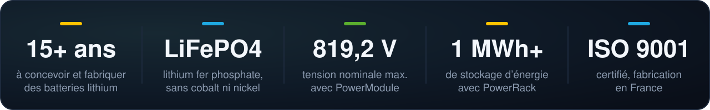

  

<h3 align="center">Batteries lithium LiFePO4 conçues et fabriquées en France depuis plus de 15 ans</h3>

  Traction électrique · Marine · Robotique et AGV · Véhicules industriels · Stockage d’énergie

  
  
  
  

## ⚡ Qui sommes-nous

**PowerTech Systems** conçoit et fabrique des batteries lithium pour la traction électrique — véhicules tout-terrain, marine, robotique, véhicules industriels — et pour le stockage stationnaire.

Spécialistes du **lithium fer phosphate (LiFePO4)**, nous faisons des batteries sûres et pensées pour le recyclage, sans cobalt, nickel ni manganèse. Nos produits sont **modulaires** : notre technologie brevetée **BMS Matrix** gère plusieurs centaines de modules pour assembler les installations les plus ambitieuses.

  

## 🔋 Nos gammes

  
  
  
  

## 🛠️ Le logiciel autour des batteries

Une batterie moderne, c’est aussi du code : celui qui la surveille, la met à jour et la fabrique. C’est ce que l’équipe développe ici, de la carte électronique jusqu’à l’application.

  

  
  
  
  
  
  
  
  

  <b>PowerTech Systems</b> · Saint-Cyr-l’École, France 
  <a href="https://www.powertechsystems.eu/fr/">Site web</a> ·
  <a href="https://www.powertechsystems.eu/fr/contact/contact-commercial/">Nous contacter</a> ·
  <a href="https://www.linkedin.com/company/powertechsystems">LinkedIn</a>

